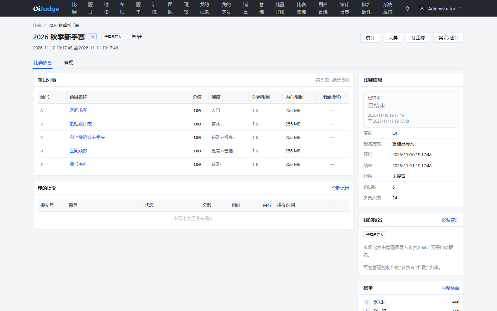
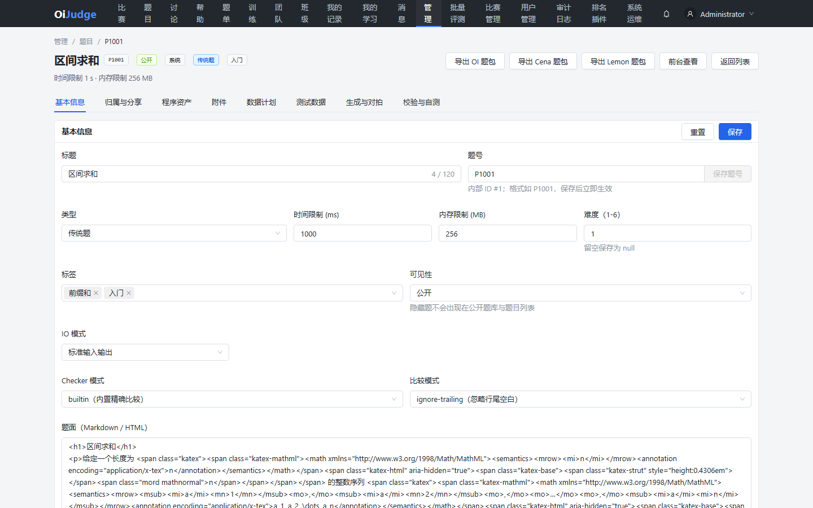
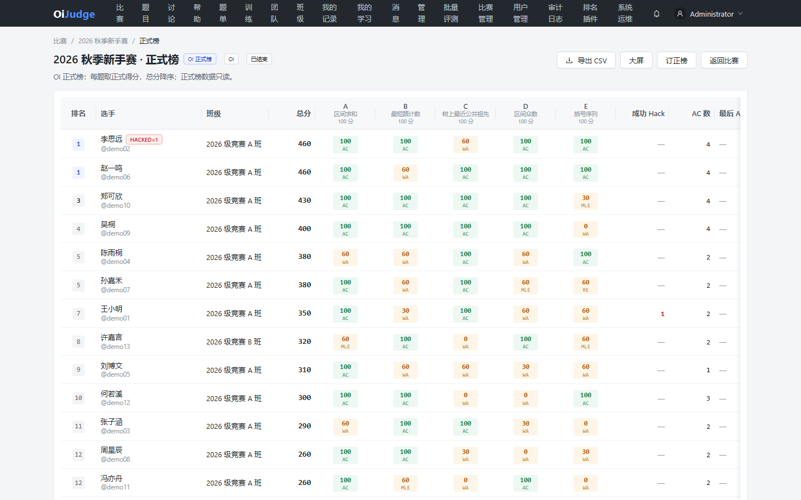
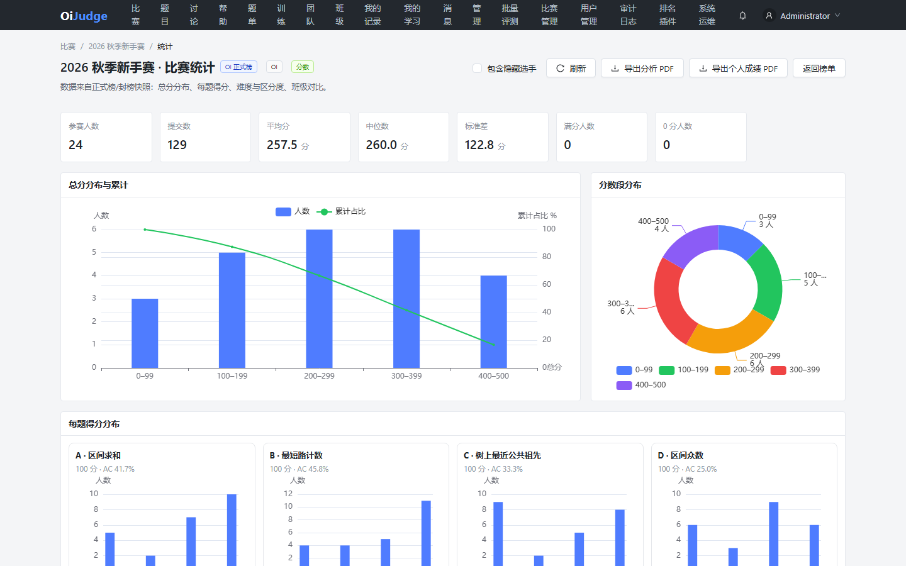
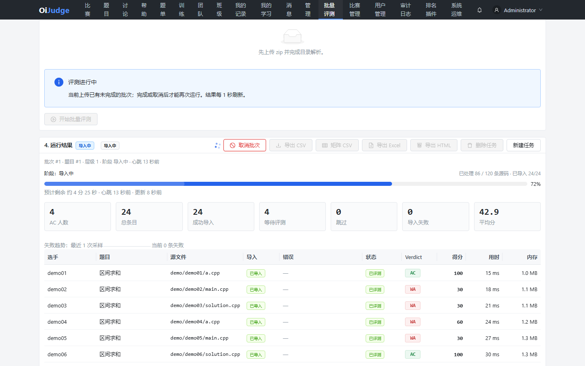
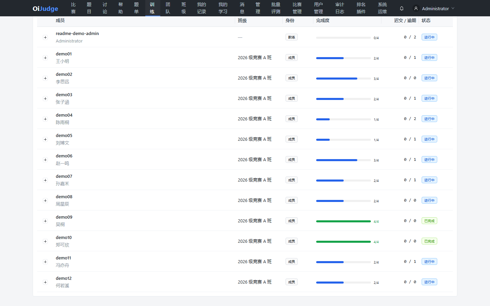
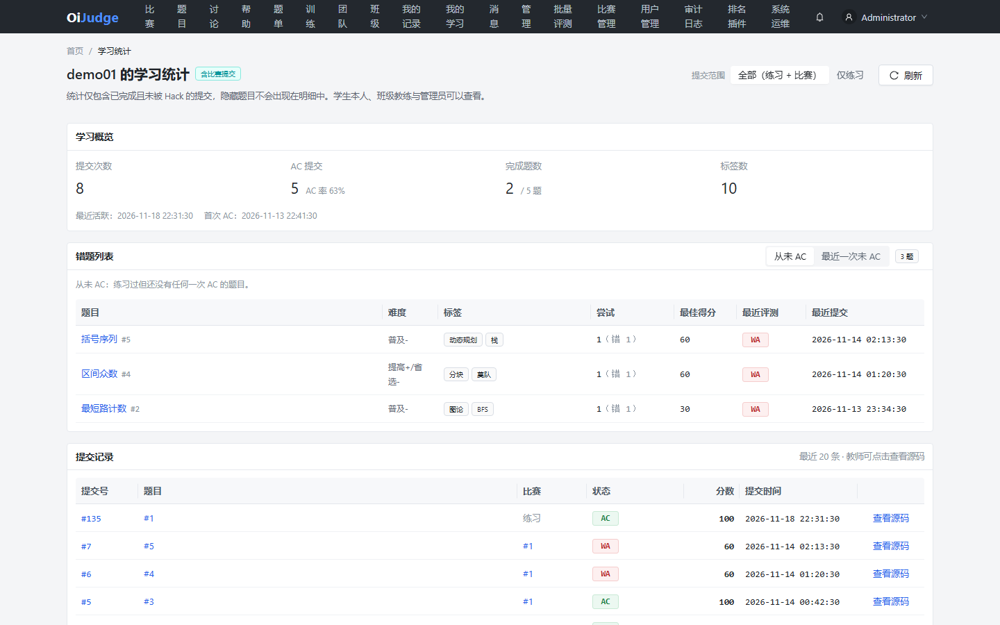
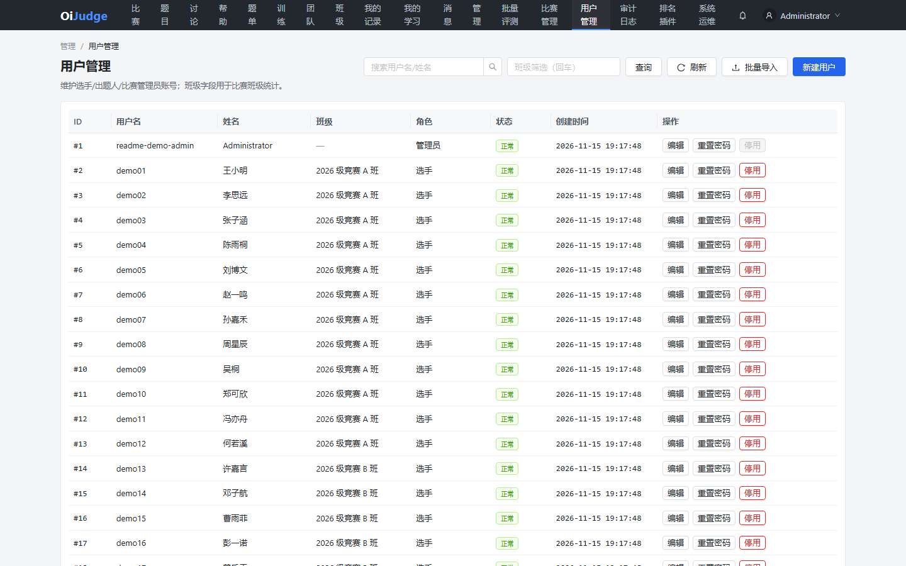
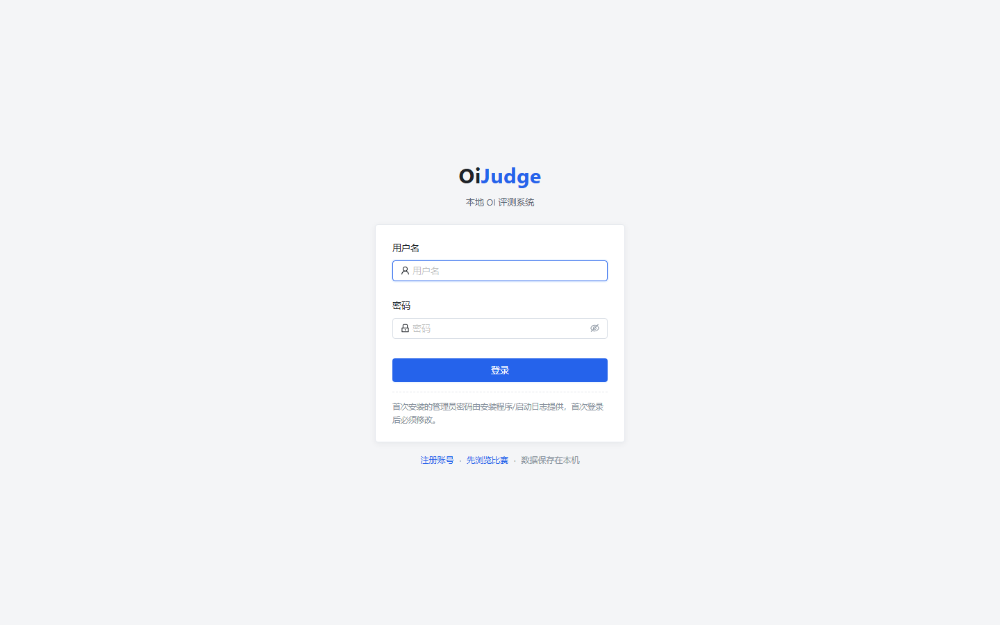

# OiJudge

**在自己的 Windows 电脑上，搭一套 OI 教学、评测和比赛系统。**

老师在电脑上安装，学生用浏览器登录、看题、提交、查看成绩。题目、代码、成绩、比赛和数据都保存在这台电脑上，不需要另外准备一台专门运行系统的电脑。

当前版本：**v1.2.0**

## 适合谁

- 学校信息学教练：建题、组织比赛、收作业、批量评测
- 比赛组织者：报名、封榜、榜单、奖项、证书
- 班级教学：班级名单、训练计划、错题与学习统计
- 想在自己电脑上练习 OI 的学生

## 亮点

### 1. 题库、出题和做题放在一起

老师可以在管理端完成一整道题的准备工作：写题面、放附件、准备标准程序、准备数据生成器、准备数据校验器、设置特殊判分和交互程序，再一键生成数据并检查。

学生端看到的是排版好的题面，支持图片和数学公式；可以看样例、下载附件、提交代码、查看每次提交的结果。

| 老师出题 | 学生看题 |
|---|---|
|  |  |

其他出题相关能力：

- 题目可以带文档、图片、压缩包等附件。
- 题目有固定编号，例如 `P1001`，方便引用和整理。
- 支持个人题目清单、团队题目清单和公开题目清单。
- 可以按人、按班级、按团队或公开设置题目可见范围。
- 支持导入 Cena、Lemon 题包，旧题可以继续使用。
- 支持按组设置测试点、分值和生成参数。
- 支持一键生成数据、自动检查数据格式和边界。
- 支持标准程序、数据生成器、数据校验器、特殊判分、交互程序和暴力对拍程序。
- 支持客观题试卷：单选、多选、判断、填空，题号从 `Y1001` 起；可单独考试，也可与编程题同场混排。

### 2. 比赛从报名到颁奖都能完成

支持个人赛、团队赛和混合赛。

报名可以三种方式：

- 管理员导入参赛名单。
- 开放报名，学生自己报名。
- 开放报名后由管理员审核。

比赛过程中支持公告、开始、结束、补时、封榜、解封和归档；归档后成绩只读，避免赛后误改。

| 比赛页面 | 正式榜单 |
|---|---|
|  |  |

比赛相关能力：

- 正式榜单实时更新，保留历史榜单和排名变化。
- 支持比赛大屏，现场展示排名和倒计时。
- 客观题与编程题可以混排在同一场比赛中，客观题按卷内小题得分计入排名。
- 支持奖项设置和证书生成。
- 支持导出比赛成绩。
- 支持生成比赛分析报告。
- 支持为每位学生生成完整成绩单。
- 支持补题和订正排名。
- 支持隐藏或恢复参赛者，成绩和提交仍然保留。
- 比赛锁题后，可以查看同题其他参赛者的代码并构造反例；成功的反例会从正式成绩中剔除，并重新计算排名。

### 3. 成绩和统计看得清楚

比赛结束后，可以直接看到参赛人数、提交次数、平均分、中位数、满分人数、零分人数，以及总分分布和每道题的得分情况。

统计页面还支持班级对比、团队对比、题目难度和区分度分析；可以导出比赛分析报告和每位学生的完整成绩单。

### 4. 批量收作业不用一个个点

老师上传一个压缩包，按“学生 / 题目 / 代码文件”的层级自动整理。

上传后先预览，确认学生和题目的对应关系，再开始导入和评测。页面会显示当前阶段、已完成数量、预计剩余时间和失败情况；刷新页面或重启程序后，任务进度仍然保留。

批量相关能力：

- 自动识别题目编号、题目标题或比赛中的题号顺序。
- 支持手动修改学生和题目的对应关系。
- 支持取消任务、从中断处继续。
- 支持查看失败项和失败原因。
- 评测结果先作为草稿，确认后才进入正式成绩。
- 发布时可以选择覆盖、取较高分或只补空缺。
- 支持导出普通表格、学生与题目交叉表、表格文件和网页表格。
- 支持比赛批量导入，也支持日常批量评测。

### 5. 教学进度和错题能长期跟踪

按班级管理学生，建立训练计划，安排题目和完成时间；查看每位学生的完成度、班级整体完成情况、错题和标签掌握度。

学生可以查看自己的学习页、错题和统计；教练可以查看学生提交的源代码。

| 班级训练进度 | 学生个人学习 |
|---|---|
|  |  |

### 6. 账号、权限和管理集中在一个地方

管理员、出题人、比赛管理员、参赛者使用不同角色，看到的页面和操作不同。

管理端支持创建、修改、停用账号，重置密码，管理比赛名单，设置题目可见范围，查看关键操作记录，以及调整系统设置。

管理端还可以：

- 设置本机访问或局域网访问。
- 设置是否开启加密访问。
- 设置同时评测数量。
- 设置登录有效时间。
- 自定义排名规则。
- 查看运行状态和系统检查结果。

### 7. 数据留在本机，备份和恢复都在管理端

题目、代码、成绩、比赛记录都保存在本机。

默认只允许本机访问；需要学生从其他电脑访问时，再由管理员开启局域网访问。

首次启动会生成随机管理员密码，第一次登录必须修改密码；旧版本的固定管理员密码会被强制修改。

支持自动备份、手动备份和恢复；升级前可以先做一次备份。

其他安全和运维能力：

- 登录失败次数过多会被限制。
- 可以选择让评测代码使用单独的低权限账户，不能直接读取系统数据、答案和重要凭据。
- 支持系统检查，方便发现异常。
- 所有内容集中在一个数据文件夹里，方便整体备份和迁移。

## 安装方式

### 运行环境

- Windows 10 或 Windows 11。
- 64 位系统。
- 不需要另外准备一台专门运行系统的电脑。

### 方式一：安装版

1. 打开发布页：

   <https://github.com/LEOOOOOOOOOISME/oi-local-judge/releases>

2. 下载 `OiJudge-Setup-1.2.0.exe`。
3. 双击安装，选择安装位置。
4. 安装完成后启动 OiJudge。

安装版会创建桌面和开始菜单快捷方式，并带有卸载程序。

### 方式二：免安装版

1. 打开同一个发布页。
2. 下载 `oi-local-judge-1.2.0-win-x64.zip`。
3. 解压到普通文件夹。
4. 双击 `OiJudge.exe` 启动。

免安装版适合放在 U 盘或临时电脑上。安装版和免安装版使用同一套数据，可以按场景切换。

### 第一次启动

- 启动后浏览器会自动打开管理页面。
- 第一次启动会显示随机管理员密码，可以复制。
- 第一次登录必须修改密码。
- 学生从其他电脑访问时，在管理端开启局域网访问，然后用浏览器打开老师电脑的地址。

### 安装前请知道

- 安装包当前没有发布者认证，Windows 可能提示“未知发布者”。
- 首次启动可能被杀毒软件扫描拖慢；第二次启动通常会快一些。
- 需要运行不完全可信的选手代码时，建议开启独立评测账户；该账户需要管理员权限创建。

