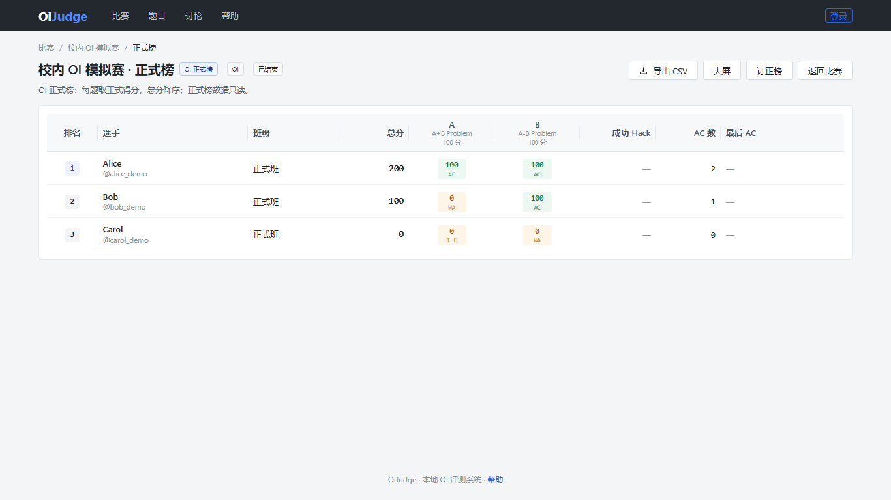
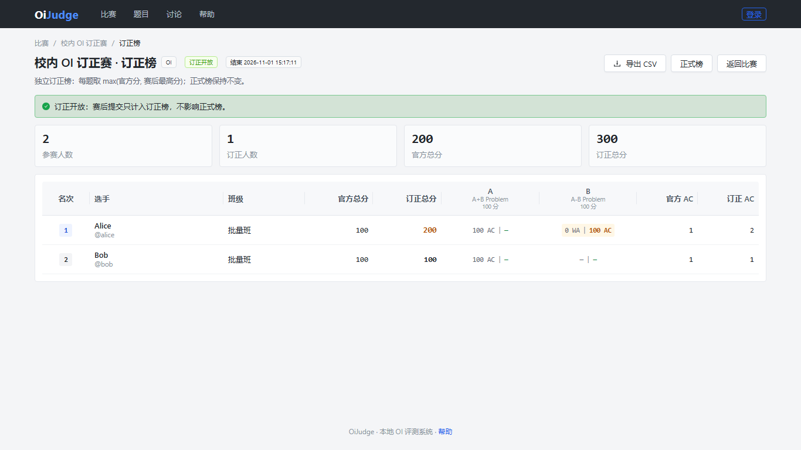
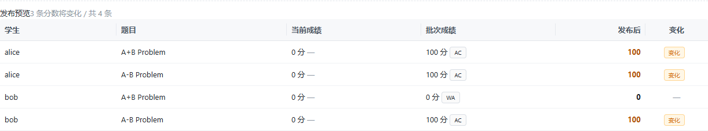
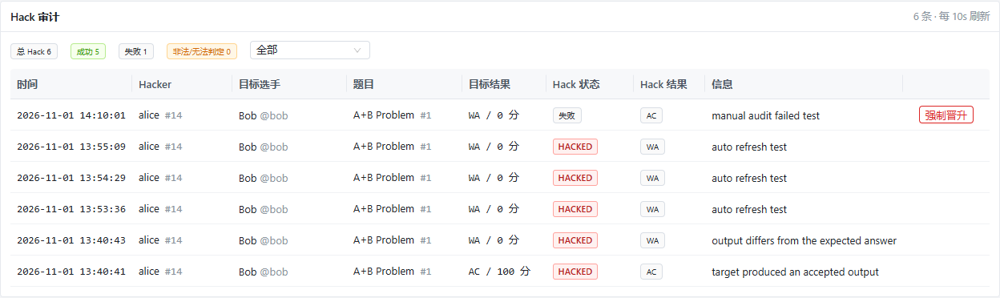
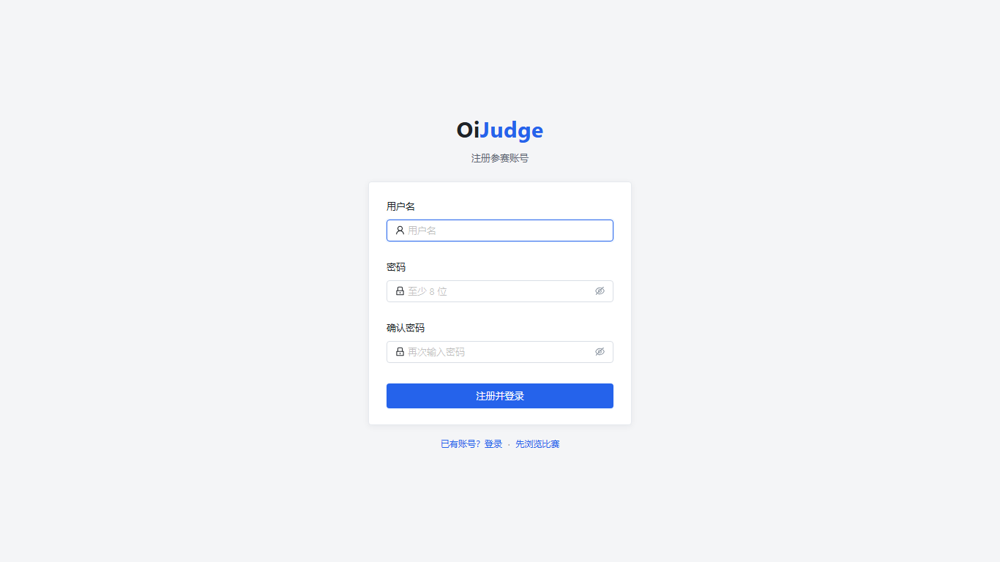
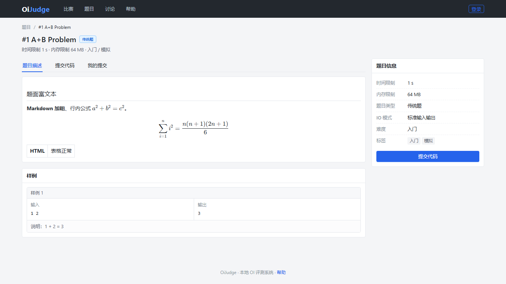

# OiJudge

> 版本：**v1.1.0-rc.10**（Windows x64 预发布）

Windows 局域网 OI 评测与比赛系统：Electron 桌面端内置服务，选手通过浏览器参赛；覆盖题库、评测、比赛、正式榜、批量导入、统计、教学训练、Hack、社区与审计。

> RC 版本不建议直接用于无备份的正式比赛。升级前请备份数据目录。

---

## 界面预览

> 以下为本地演示数据截图，实际界面以当前版本为准。

| 正式榜 | 赛后订正榜 |
|---|---|
|  |  |

| 批量导入预览 | Hack 审计 |
|---|---|
|  |  |

| 注册 | Markdown / LaTeX 题面 |
|---|---|
|  |  |

---

## 简介

OiJudge 面向学校、教练和本地比赛组织者，目标是在一台 Windows 机器上完成：

- 出题、导入数据、SPJ / 交互题 / 客观题
- 建赛、报名、封榜、大屏、正式榜
- 在线提交与教师批量导入统一评测
- 赛后统计、分析 PDF、完整成绩单
- 班级、训练计划、学习统计
- 题目附件、分类题号、题单分享
- Windows 安装包与便携版

数据默认保存在本机 SQLite 与本地目录，不依赖公网服务。

---

## 核心能力

### 评测

- C++14 / C++17 / C++20、C11
- 传统题、文件 IO、testlib SPJ、交互题、提交答案题、客观题
- 子任务依赖、部分分、Hack、重测、取消评测
- Job Object 资源限制：CPU、墙钟、内存、进程数
- 编译缓存、checker 缓存、崩溃恢复、OLE
- 评测队列持久化，在线提交优先于批量任务

### 比赛

- OI / IOI / ACM / CF-like 排名
- 草稿 / 运行 / 封榜 / 结束 / 归档
- 个人 / 团队 / 混合报名
- 管理员导入 / 开放报名 / 审核报名
- 审核、签到、监考、大屏、奖项、证书
- 正式榜缓存与 WebSocket 增量
- 补题 / 订正排名、Hack、比赛结果报告
- 正式榜服务端分页与搜索

### 批量评测

- 5000 人级多题批量导入
- 流式 ZIP 上传与流式解压
- 学生/题目层级预览、无效学生、重复项报告
- 可视化映射：个人/团队/公共题目、顺序绑定、手动修改
- 后台异步导入、500 条事务、单条失败隔离
- 重启恢复、任务取消、失败项跳过
- 服务端持久进度：阶段、心跳、ETA、失败趋势
- 刷新页面后通过 `/admin/batch/:jobId` 恢复
- CSV、矩阵 CSV、Excel、HTML 导出
- 批次提交与在线提交共用多核评测队列

### 统计与教学

- 比赛统计仪表盘：KPI、分布、累计、每题、难度/区分度、班级/团队对比
- 分析报告 PDF、完整个人成绩 PDF
- ECharts 按需加载、虚拟滚动、5000+ 服务端分页
- 班级 = 团队的一种，支持多教练、参赛开关
- 训练计划、成员完成度、逾期
- 错题、标签掌握度、班级学习统计、14 天未活跃
- 教练查看学生提交源码并审计

### 题库与出题

- Markdown + KaTeX + 安全 HTML 题面
- Data Plan：测试点、子任务、生成器、质量门禁
- std / checker / validator / generator / interactor / judger / brute
- 题目所有权、可见性、ACL、题单分享
- 洛谷式分类题号：`P1001…`，旧数字 URL 兼容
- 题目附件：PDF / 图片 / ZIP，权限下载
- OI / Cena / Lemon 题包导入导出

### 安全与运维

- 首次启动随机管理员密码，强制首次改密
- Session 密钥自动生成并持久化
- 默认只监听 `127.0.0.1`，LAN 显式开启
- 登录失败限流先于密码校验；有界 TTL 限流 Map
- 可选内置 HTTPS，Cookie 自动 `Secure`
- 可选独立 Windows worker 账户、数据目录 ACL、防火墙出站阻断
- 自动备份、恢复快照、系统诊断、监控指标
- Windows 一键部署脚本、NSIS 安装包、便携版

---

## 快速开始

### 方式一：下载发布包

从 GitHub Releases 下载与 tag 对应的文件：

- `OiJudge-Setup-<version>.exe`：NSIS 安装器
- `oi-local-judge-<version>-win-x64.zip`：便携版

最新预发布：

<https://github.com/LEOOOOOOOOOISME/oi-local-judge/releases>

安装版与便携版共用数据目录；具体路径以启动日志/安装向导为准。

### 方式二：源码运行

环境要求：

- Windows 10/11 x64
- Node.js 24+
- MinGW-W64 GCC（C++17）
- CMake 3.20+（构建原生 runner）

```powershell
npm install --ignore-scripts --cache .npm-cache
npm run build:native
npm run build
npm run seed
npm start
```

访问：

```text
http://127.0.0.1:8787
```

首次启动没有默认管理员密码：

- CLI 启动横幅打印一次性随机管理员密码；
- Electron 弹出原生对话框，可复制；
- 首次登录必须修改密码；
- 旧库中的 `admin/admin123` 会在升级时强制改密并吊销旧会话。

> 不要设置 `OIJ_ADMIN_PASSWORD=admin123`。该变量只用于自动化/CI 的显式初始化。
> 显式 `OIJ_SESSION_SECRET` 必须至少 32 字符，且不能是旧默认值。

### 局域网访问

默认只监听 loopback。需要局域网访问时显式开启：

```powershell
$env:OIJ_LAN = '1'          # 或 OIJ_HOST=0.0.0.0
```

建议同时配置 HTTPS：

```powershell
$env:OIJ_TLS_CERT = 'C:\certs\oij-cert.pem'
$env:OIJ_TLS_KEY  = 'C:\certs\oij-key.pem'
```

TLS 会自动给 Session Cookie 加 `Secure`。如果 TLS 由反向代理终止，可设置
`OIJ_COOKIE_SECURE=1`。没有 TLS 的 LAN 只应部署在可信隔离网络。

### Windows 部署脚本

```powershell
powershell -ExecutionPolicy Bypass -File tools\deploy\windows\install.ps1
```

常用参数：

- `-Lan`：开放局域网与防火墙
- `-WorkerIsolation`：创建低权限判题账户、设置 ACL 与出站防火墙阻断

```powershell
powershell -ExecutionPolicy Bypass -File tools\deploy\windows\install.ps1 -Lan -WorkerIsolation
```

---

## 安全模型

默认配置是“本机优先”：

- 只监听 `127.0.0.1`
- 管理员密码随机生成
- Session 密钥随机生成并持久化
- 不提供公开默认凭据

面向**不可信选手代码**时，请启用 worker 隔离：

```powershell
$env:OIJ_WORKER_ISOLATION = 'required'
```

并按 `install.ps1 -WorkerIsolation` 创建独立 worker 账户。`required` 缺少凭据或 ACL 失败时服务会拒绝启动，不会回退到服务账户。

> 当前 worker 账户的真实创建、`CreateProcessWithLogonW` 成功路径与 stdio/Job 组合仍需在管理员 Windows 会话补做实机验收；未验证前不要把默认 `optional` 模式当作强安全沙箱。

---

## 配置

| 环境变量 | 说明 | 默认 |
|---|---|---|
| `OIJ_DATA_DIR` | 数据目录 | 仓库下 `runtime/` |
| `OIJ_PORT` | HTTP/HTTPS 端口 | `8787` |
| `OIJ_HOST` | 监听地址 | `127.0.0.1` |
| `OIJ_LAN` | `1` 时监听 `0.0.0.0` | 关闭 |
| `OIJ_ADMIN_USERNAME` | 初始管理员用户名 | `admin` |
| `OIJ_ADMIN_PASSWORD` | 显式初始化密码（仅自动化） | 无；随机生成 |
| `OIJ_SESSION_SECRET` | 显式 Session 密钥，至少 32 字符 | 自动生成并持久化 |
| `OIJ_SESSION_TTL` | Session 有效期（秒） | `28800` |
| `OIJ_TLS_CERT` / `OIJ_TLS_KEY` | 内置 HTTPS 证书/私钥 | 无 |
| `OIJ_COOKIE_SECURE` | 反代 TLS 时强制 Secure Cookie | 随 TLS 自动 |
| `OIJ_GXX` | g++ 路径 | 自动探测 |
| `OIJ_JUDGE_CONCURRENCY` | 评测并发 | `min(4, CPU 核数)` |
| `OIJ_RUNNER` | ojrunner 路径 | `native/runner/out/ojrunner.exe` |
| `OIJ_INTERACT_RUNNER` | ojinteract 路径 | `native/interact/out/ojinteract.exe` |
| `OIJ_WORKER_ISOLATION` | `optional` / `required` | `optional` |
| `OIJ_WORKER_USER` | worker 账户 | `worker.json` |
| `OIJ_WORKER_PASSWORD` | worker 密码 | `worker.json` |

---

## 常用命令

```powershell
npm run build              # shared + server + desktop + web
npm run build:native       # ojrunner + ojinteract
npm start                  # 启动服务
npm test                   # 全量 Vitest
npm run test:e2e:browser   # Playwright 浏览器 E2E
npm run typecheck          # TypeScript 检查

npm run bench              # 微基准
npm run bench:concurrency  # 并发提交基准
npm run bench:compile      # 编译基准

npm run build:portable     # 便携目录 + ZIP
npm run build:installer    # NSIS 安装器
npm run release:bump -- 1.1.0-rc.11
```

---

## 技术架构

```text
Electron 桌面壳
  │
  ├── Fastify HTTP/WS 服务
  │     ├── auth / users / contests / problems / submissions
  │     ├── official ranking / correction ranking
  │     ├── batch import / batch progress / export
  │     ├── contest statistics / class / training
  │     ├── attachments / numbering / problem sets
  │     └── hack / audit / freeze / community
  │
  ├── React + Vite + Ant Design Web
  │     ├── 选手端
  │     ├── 管理端
  │     ├── 比赛大屏
  │     └── 帮助中心
  │
  ├── SQLite WAL
  │     └── <dataDir>/db/oijudge.db
  │
  └── Native
        ├── ojrunner.exe   Job Object / 可选 worker 账户
        └── ojinteract.exe 双向管道交互
```

技术栈：

- Electron 45
- TypeScript
- React 18 + Vite 7
- Ant Design 5
- TanStack Query
- Fastify 5
- Node.js 24
- `node:sqlite` WAL
- C++17 原生 runner
- testlib.h（MIT）

---

## 数据目录

默认：

```text
runtime/
  db/oijudge.db
  problems/
  submissions/
  cache/
  tmp/
  plugins/
  hacks/
  logs/
  backups/
```

评测工作目录位于 dataDir 同级，避免选手代码直接接触数据库、答案和密钥。

---

## 当前限制

- **4C/8G 目标机验收未完成**：2 小时 / 300 在线 / 50 并发未正式验收。
- **5000×4 压测未执行**：批量功能和 5000 行级链路已实现，真实 20,000 提交压测仍待做。
- **worker 账户实机成功路径未验证**：需要管理员 Windows 会话创建账户并验证 stdio/Job；默认 `optional`。
- **安装包未签名**，使用默认 Electron 图标，SmartScreen 可能提示。
- 首次冷启动可能受 Defender 扫描影响；当前服务启动超时 60 秒。
- 题目附件单文件 50 MiB 仍为内存缓冲；删除题目不会清理附件文件；批量源码单文件上限为 512 MiB。
- 题目 picker 上限 500 题。
- 统计搜索仅覆盖用户名/姓名/班级，不含排名/分数/题号。
- 隐藏选手对团队聚合的严格排除尚未完成。
- Windows 当前是托盘/启动项/脚本部署，不是 SCM 服务。
- Python 3 评测尚未接入；交互题使用自定义 argv/stdin/stdout 协议，testlib `registerInteraction` 完整兼容未完成。
- 代码查重按需求不做。
- 浏览器 E2E 仅覆盖主要流程与建班/学生访问，统计打印/批量全流程仍以单元/接口测试为主。
- 备份为目录复制，不是压缩归档；大目录会同步阻塞。

---

## 文档

- [发布说明](docs/releases/RELEASE_NOTES.md)
- [进度记录](docs/PROGRESS.md)
- [需求规格](requirement.txt)
- [技术设计](docs/superpowers/specs/2026-10-31-oi-judge-design.md)
- [排名与赛制](docs/ranking.md)
- [比赛批量导入](docs/batch-import.md)
- [Windows 部署](docs/help/maintenance/windows-deploy.md)
- [帮助中心](docs/help/)

---

## 许可证

待定。第三方组件（testlib.h 等）的许可证与声明在引入时保留。
