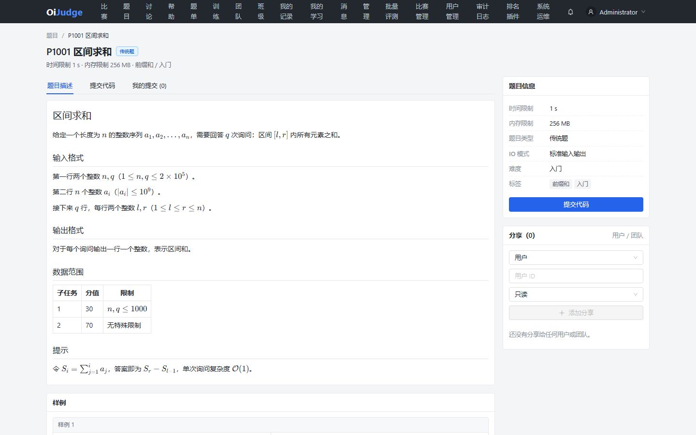

# OiJudge

**在 Windows 上搭一套自己的 OI 评测和比赛系统。**

老师在电脑上安装 OiJudge，学生用浏览器登录、看题、提交代码、查看成绩。题目、比赛、评测记录和数据都保存在这台电脑上，不依赖外部服务器。

当前版本：**v1.1.3**

---

## 适合谁

- 学校信息学教练：建题、组织比赛、收作业、批量评测
- 比赛组织者：报名、封榜、榜单、奖项、Hack
- 班级教学：班级名单、训练计划、错题与学习统计
- 想在自己电脑上练习 OI 的学生

## 能做什么

### 评测

- 支持传统题、文件 IO、SPJ、交互题、客观题、提交答案题
- 支持 C++14 / C++17 / C++20、C11
- 支持 OI、IOI、ACM、CF-like 排名
- 子任务、部分分、重测、取消评测
- 编译缓存、崩溃恢复、输出限制

### 比赛

- 个人、团队、混合报名
- 管理员导入名单，或开放/审核报名
- 封榜、解封、归档、比赛大屏
- 奖项、证书、成绩导出
- 补题、订正排名、Hack
- 正式榜实时更新与历史快照

### 批量收作业

- 上传一个 ZIP，按“学生/题目/源码”自动整理
- 先预览，确认学生和题目对应关系
- 后台导入、评测，页面可查看进度
- 刷新页面或重启后继续显示任务进度
- 支持取消、恢复、失败项报告
- 导出 CSV、Excel、HTML，或学生×题目矩阵

### 统计与教学

- 比赛统计：分数分布、每题情况、难度/区分度、班级/团队对比
- 一键生成分析报告 PDF
- 导出完整个人成绩 PDF
- 班级、训练计划、成员完成度
- 错题、标签掌握度、班级学习统计
- 教练可以查看学生提交源码

### 题库

- 富文本题面，支持 Markdown 和数学公式
- 测试数据、子任务、SPJ、交互题、客观题
- 题目附件：PDF、图片、ZIP
- 分类题号，如 `P1001`
- 题单：个人、团队、公开
- 支持导入 Cena、Lemon 题包

### 数据与安全

- 数据保存在本机，默认只允许本机访问
- 首次启动生成随机管理员密码，必须改密
- 可开启局域网访问
- 可开启 HTTPS
- 可选用独立低权限账户运行评测代码
- 自动备份、恢复、系统诊断

## 快速开始

### 方式一：安装包

从 GitHub Releases 下载：

- `OiJudge-Setup-1.1.3.exe`：安装版
- `oi-local-judge-1.1.3-win-x64.zip`：便携版

发布页：

<https://github.com/LEOOOOOOOOOISME/oi-local-judge/releases>

安装后启动 OiJudge，浏览器会自动打开管理页面。

### 方式二：源码运行

需要：

- Windows 10/11 x64
- Node.js 24+
- MinGW-W64 g++
- CMake 3.20+

```powershell
npm install --ignore-scripts --cache .npm-cache
npm run build:native
npm run build
npm run seed
npm start
```

访问：

```text
http://127.0.0.1:8787
```

## 第一次启动

没有默认管理员密码。

- 命令行启动时，终端会显示一次性随机密码
- Electron 启动时，会弹窗显示，可直接复制
- 第一次登录必须修改密码

如果从旧版本升级，旧的管理员默认密码会被强制修改，并让旧登录状态失效。

## 局域网访问

默认只有本机能访问。需要学生从别的电脑打开时，显式开启局域网：

```powershell
$env:OIJ_LAN = '1'
```

或：

```powershell
$env:OIJ_HOST = '0.0.0.0'
```

建议同时启用 HTTPS：

```powershell
$env:OIJ_TLS_CERT = 'C:\certs\oij-cert.pem'
$env:OIJ_TLS_KEY  = 'C:\certs\oij-key.pem'
```

没有 HTTPS 的局域网只适合可信网络。

## 评测隔离

默认以启动 OiJudge 的 Windows 用户运行评测程序。

如果你要运行不受信任的代码，请在安装时勾选“启用判题账户隔离”，或运行：

```powershell
powershell -ExecutionPolicy Bypass -File tools\deploy\windows\install.ps1 -WorkerIsolation
```

然后设置：

```powershell
$env:OIJ_WORKER_ISOLATION = 'required'
```

启用后，评测程序使用独立低权限账户，不能直接读取数据目录中的数据库、答案和密钥。

> 该模式的真实账户创建与运行需要在管理员 Windows 会话中验证；未启用时不要把它当作强安全沙箱。

## 批量导入

目录结构示例：

```text
学生姓名/题目编号/main.cpp
学生姓名/题目编号/answers.json
```

流程：

1. 上传 ZIP
2. 确认学生和题目的层级
3. 检查预览，修正题目对应关系
4. 后台导入并评测
5. 查看进度，刷新页面不会丢
6. 预览成绩，选择发布
7. 导出成绩

## 界面

> 截图来自本地演示数据，实际界面以当前版本为准。

| 登录 | 题目 |
|---|---|
|  |  |

| 比赛 | 正式榜 |
|---|---|
|  |  |

| 统计 | 批量任务 |
|---|---|
|  |  |

| 班级/训练 | 管理端 |
|---|---|
|  |  |

## 常用配置

| 配置 | 作用 | 默认 |
|---|---|---|
| `OIJ_DATA_DIR` | 数据目录 | 项目下 `runtime/` |
| `OIJ_PORT` | 端口 | `8787` |
| `OIJ_HOST` | 监听地址 | `127.0.0.1` |
| `OIJ_LAN` | 设为 `1` 开启局域网 | 关闭 |
| `OIJ_ADMIN_USERNAME` | 初始管理员用户名 | `admin` |
| `OIJ_ADMIN_PASSWORD` | 自动化初始化密码 | 随机生成 |
| `OIJ_SESSION_SECRET` | 登录签名密钥 | 自动生成 |
| `OIJ_TLS_CERT` | HTTPS 证书 | 无 |
| `OIJ_TLS_KEY` | HTTPS 私钥 | 无 |
| `OIJ_COOKIE_SECURE` | 反代 HTTPS 时强制安全 Cookie | 随 TLS |
| `OIJ_GXX` | g++ 路径 | 自动查找 |
| `OIJ_JUDGE_CONCURRENCY` | 同时评测数 | 自动 |
| `OIJ_WORKER_ISOLATION` | 评测账户隔离 | `optional` |

## 数据与备份

默认数据目录：

```text
runtime/
  db/           数据库
  problems/     题目、数据、附件
  submissions/  提交源码
  cache/        编译缓存
  logs/         日志
  backups/      备份
```

可以在管理端创建/恢复备份，也可以用 `OIJ_DATA_DIR` 指向其他磁盘。

升级前请先备份。

## 常用命令

```powershell
npm run build              # 构建 Web/服务端/桌面端
npm run build:native       # 构建评测器
npm start                  # 启动
npm test                   # 单元/接口测试
npm run test:e2e:browser   # 浏览器流程测试
npm run build:portable     # 便携版
npm run build:installer    # 安装包
```

## 文档

- [发布说明](docs/releases/RELEASE_NOTES.md)
- [技术设计与维护](docs/help/)
- [排名与赛制](docs/ranking.md)
- [批量导入](docs/batch-import.md)
- [Windows 部署](docs/help/maintenance/windows-deploy.md)
- [发布构建](docs/help/maintenance/release.md)

## License

Apache License 2.0，见 [LICENSE](LICENSE) 与 [NOTICE](NOTICE)。  
第三方组件声明见 [THIRD_PARTY_NOTICES.md](THIRD_PARTY_NOTICES.md)。
