# OiJudge｜不只是 OJ

**一台 Windows 电脑，装下出题、评测、办赛、收作业、教学统计。**

> 网页版：[打开 `showcase.html`](showcase.html)（更适合投屏或直接发给同事）

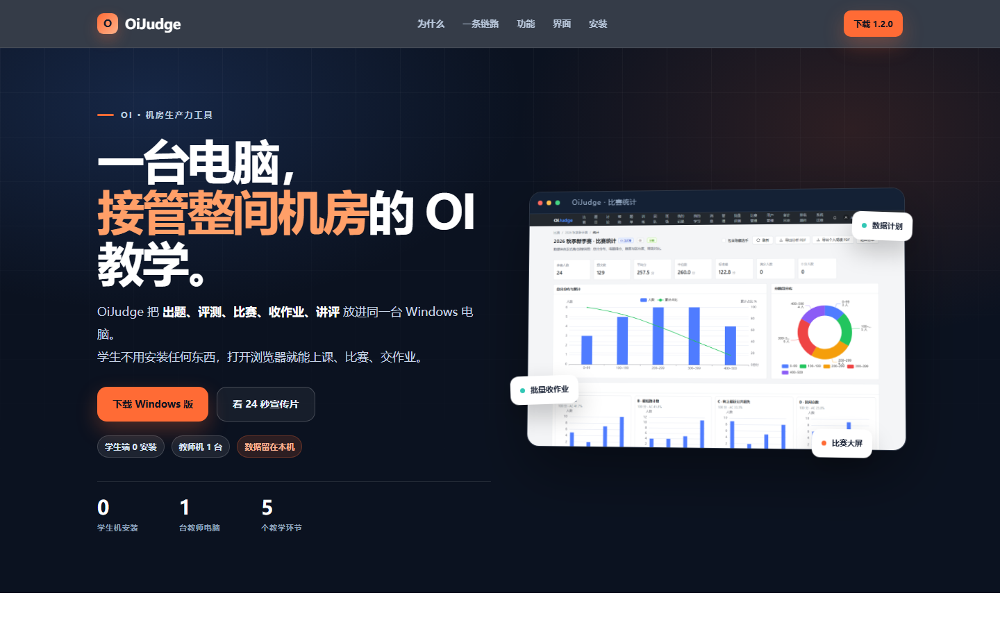

平时说到 OJ，想到的往往是：

> 交题 → 判题 → 看排名

OiJudge 把这条线往后延伸了一大截：

> 出题 → 评测 → 办赛 → 收作业 → 讲评 → 看进步

而且是**本地运行**。题目、代码、成绩、比赛记录，都留在自己的电脑上。

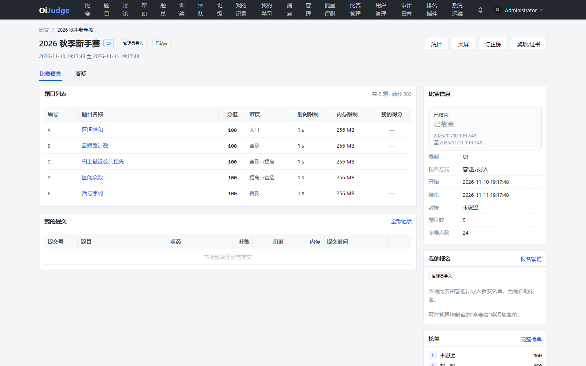

> **24 秒宣传片**：用 EAC design world 的 19-paperclip 模板制作，真实界面推拉 + 大字关键词 + 本地配乐。  
> [播放 / 下载 MP4](docs/assets/oi-judge-promo.mp4)

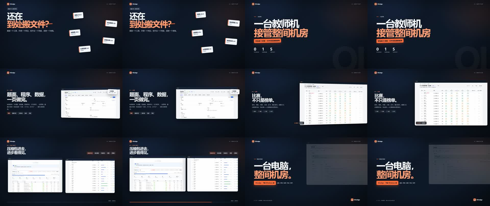

---

## 01｜出题：不是上传数据，是把题做完整

**题面 · 标准程序 · 生成器 · 校验器 · 对拍 · 数据计划**

- 题面支持排版、图片和数学公式
- 标准程序、数据生成器、数据校验器、特殊判分、交互程序，一处管理
- 数据计划用一张表说清：分几组、每组几个点、每组多少分
- 一键生成数据，再自动检查格式和边界
- 生成器和暴力程序对拍，主动找反例

| 老师出题 | 数据计划 |
|---|---|
| 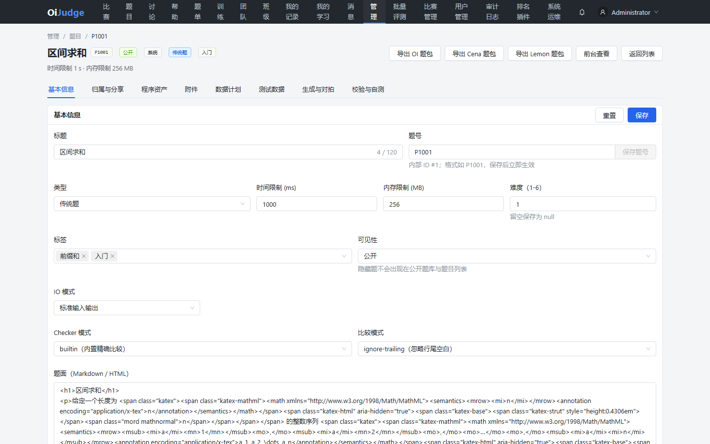 | 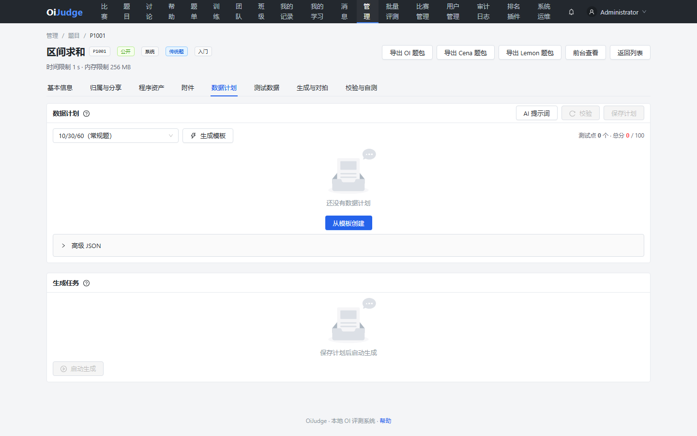 |

**关键词：出题流水线 / 数据计划 / 一键生成 / 对拍**

很多 OJ 只负责“收题”和“判题”。OiJudge 把出题前后的准备工作也接进来了。

---

## 02｜比赛：不是排个榜，是从报名办到颁奖

**报名 · 团队 · 封榜 · 大屏 · 证书 · 反例**

- 个人赛、团队赛、混合赛
- 管理员导入名单，或开放报名、审核报名
- 封榜、解封、归档，赛后成绩只读
- 比赛大屏：排名、倒计时、现场状态
- 奖项、证书、成绩报告
- 锁题后查看同题代码，构造反例；成功的反例重新计分

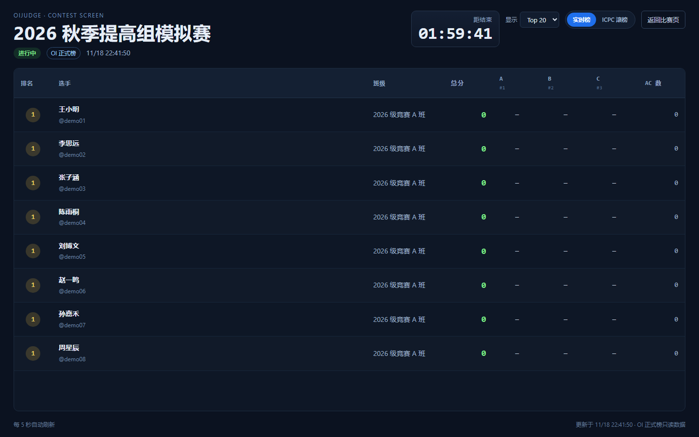

比赛不只是“榜单页面”。报名、现场、颁奖、赛后报告，都在同一个系统里。

**关键词：报名管理 / 封榜 / 大屏 / 证书 / 反例**

---

## 03｜收作业：压缩包进去，成绩表出来

**预览 · 草稿 · 后台 · 断点 · 导出**

- 上传压缩包，按“学生 / 题目 / 代码”自动整理
- 先预览：谁匹配上了、谁没匹配上、哪些文件有问题
- 确认后再导入和评测
- 页面显示阶段、进度、预计剩余时间
- 刷新页面、重启程序，任务进度还在
- 支持取消、继续、失败项报告
- 结果先做草稿，确认后才进正式成绩
- 导出普通表格、交叉表、Excel、网页表格

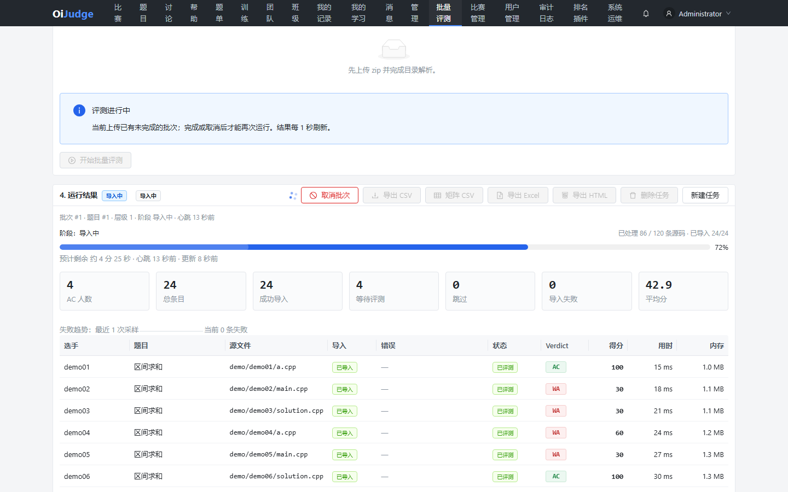

很多 OJ 的“批量导入”只是上传。OiJudge 把它做成了**可预览、可暂停、可恢复、可发布**的完整流程。

**关键词：批量收作业 / 预览 / 草稿 / 断点续跑 / 多格式导出**

---

## 04｜教学：判完不是结束，进步要看得见

**班级 · 训练计划 · 错题 · 标签掌握度**

- 按班级管理学生
- 建训练计划，安排题目和完成时间
- 看每位学生的完成度
- 看班级整体完成情况
- 看错题、看标签掌握度
- 教练可以查看学生提交的代码
- 学生可以看自己的学习页、错题和统计

| 班级训练进度 | 学生个人学习 |
|---|---|
| 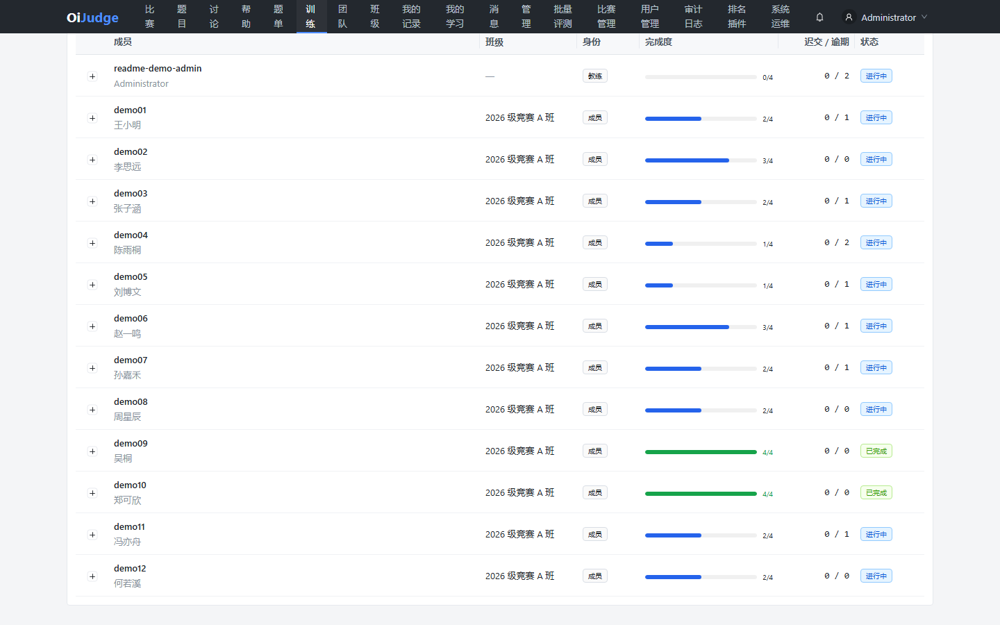 | 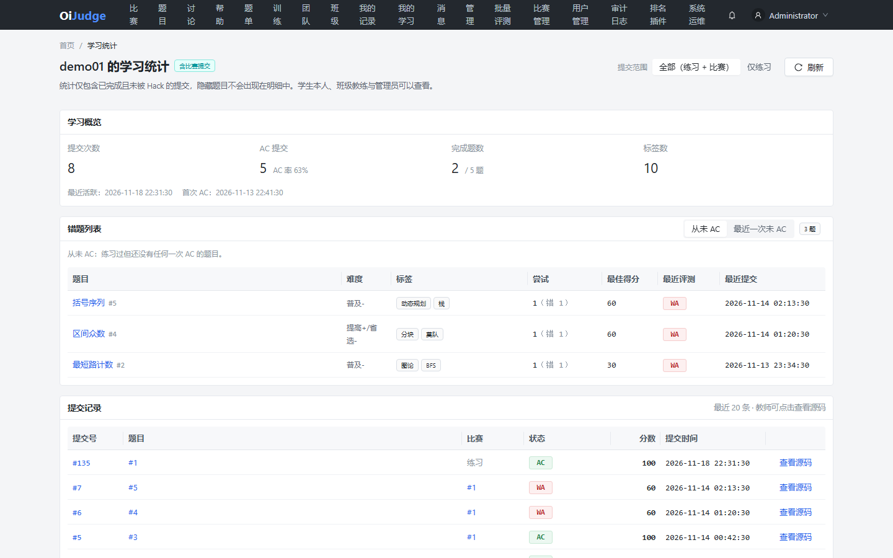 |

很多 OJ 的终点是“这次得了多少分”。OiJudge 继续回答：**哪些题不会、哪个知识点薄弱、下一步练什么。**

**关键词：班级 / 训练计划 / 错题本 / 掌握度 / 学习报告**

---

## 05｜统计：一场比赛，拆开看

**分布 · 每题 · 难度 · 区分度 · 对比**

- 参赛人数、提交次数、平均分、中位数
- 满分人数、零分人数
- 总分分布、分数段分布
- 每道题的得分分布
- 班级对比、团队对比
- 题目难度、区分度
- 导出比赛分析报告、学生成绩单

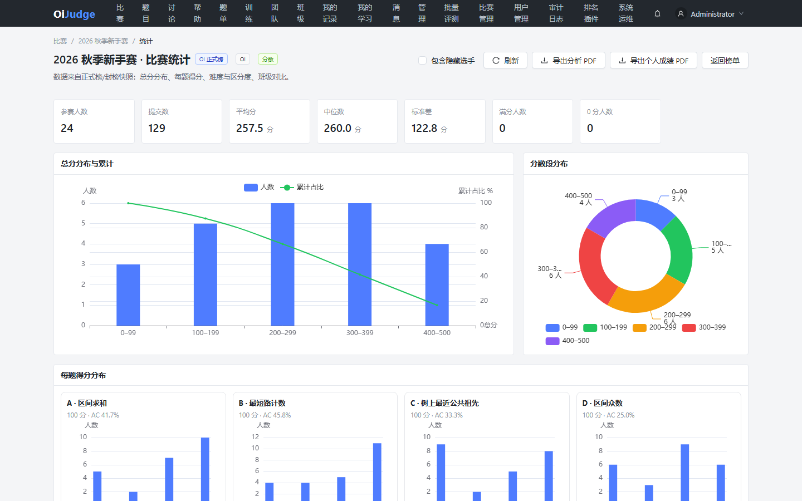

不是只给一个总分，而是把一场比赛拆成可以讲评的数据。

**关键词：比赛统计 / 分数分布 / 难度 / 区分度 / 报告**

---

## 06｜管理：数据在自己手里

**本机 · 随机密码 · 备份 · 恢复 · 独立评测账户**

- 数据保存在本机
- 默认只允许本机访问
- 首次启动随机管理员密码，第一次登录必须改密
- 自动备份、手动备份、恢复
- 系统检查、运行状态
- 需要运行不完全可信的代码时，可以用独立低权限账户

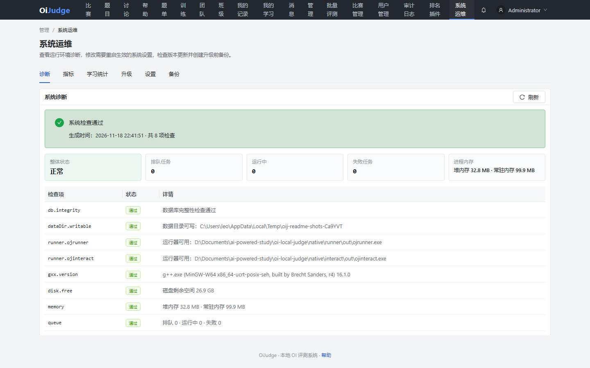

很多在线 OJ 的数据在平台服务器上。OiJudge 的数据在自己的电脑上，**备份和恢复也在自己的管理端**。

**关键词：本地数据 / 默认内网 / 随机密码 / 备份 / 恢复 / 独立账户**

---

## 07｜和普通 OJ 的区别，一张表

| 常见 OJ | OiJudge |
|---|---|
| 题库、提交、判题、排名 | 题库、出题、评测、办赛、作业、教学、统计 |
| 出题靠外部工具 | 题面、程序、数据、校验、对拍一处完成 |
| 比赛主要是榜单 | 报名、封榜、大屏、奖项、证书、报告 |
| 批量导入是上传文件 | 预览、草稿、后台进度、断点、发布、导出 |
| 教学数据要另外记 | 班级、训练、错题、标签掌握度 |
| 数据在平台服务器 | 数据在本机，自己备份 |
| 一个网站 | 一个 Windows 程序 + 学生浏览器 |

---

## 08｜适合谁

- **学校教练**：建题、办赛、收作业、讲评
- **比赛组织者**：报名、封榜、大屏、颁奖
- **班级老师**：训练计划、完成度、错题、统计
- **自己练 OI 的学生**：题库、评测、排名、学习记录

---

## 09｜安装

**Windows 10 / 11，一台电脑即可。**

1. 打开发布页：
   <https://github.com/LEOOOOOOOOOISME/oi-local-judge/releases>
2. 下载安装版 `OiJudge-Setup-1.2.0.exe`，或免安装版 `oi-local-judge-1.2.0-win-x64.zip`
3. 启动 OiJudge
4. 浏览器自动打开管理页
5. 首次启动会显示随机管理员密码，登录后修改

学生从其他电脑访问时，在管理端开启局域网访问，用浏览器打开老师电脑的地址。

---

## 10｜一句话总结

**OiJudge 不是“再多一个判题网站”，而是把老师办 OI 的整套流程，放回自己电脑上。**

#OI #本地部署 #出题工具 #比赛系统 #批量评测 #教学统计 #数据在自己手里
